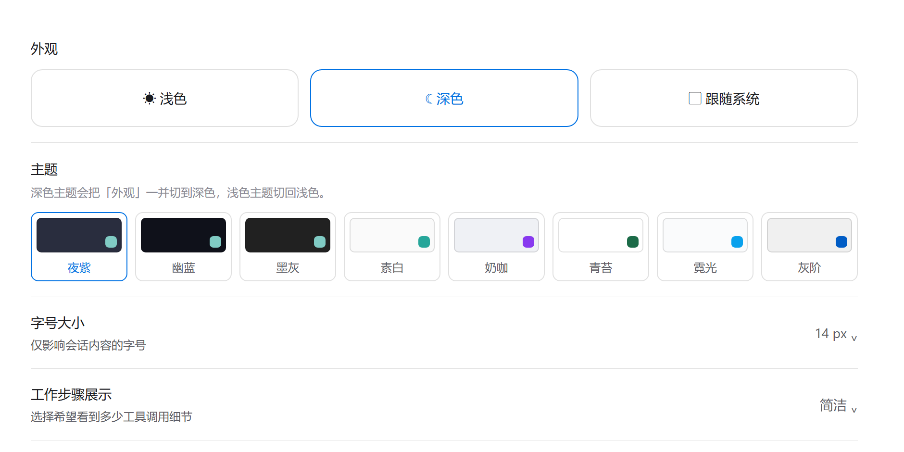
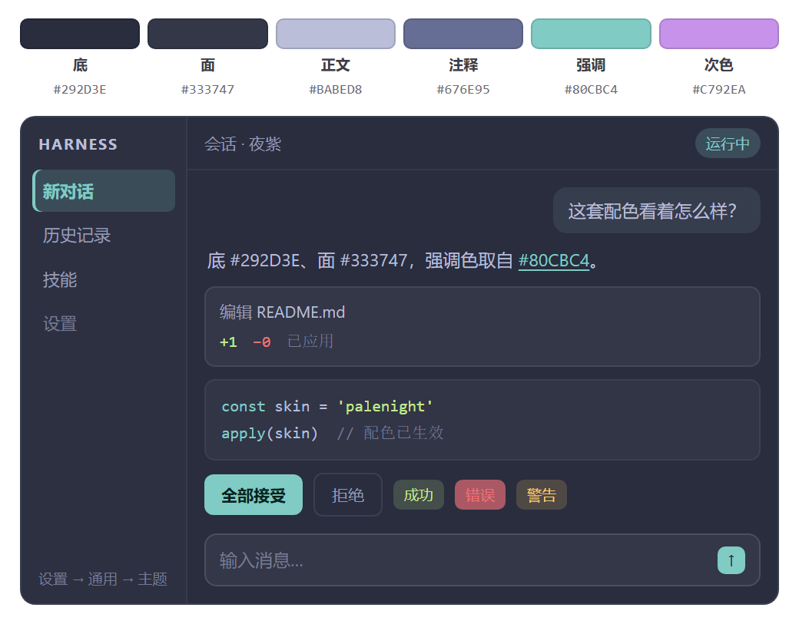
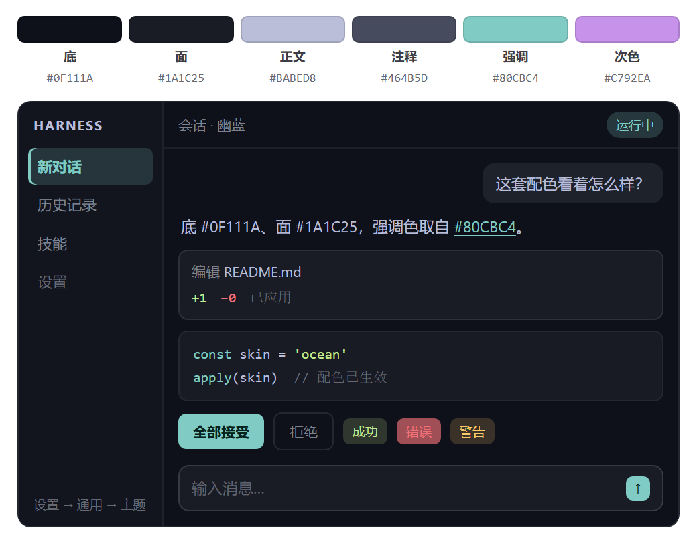
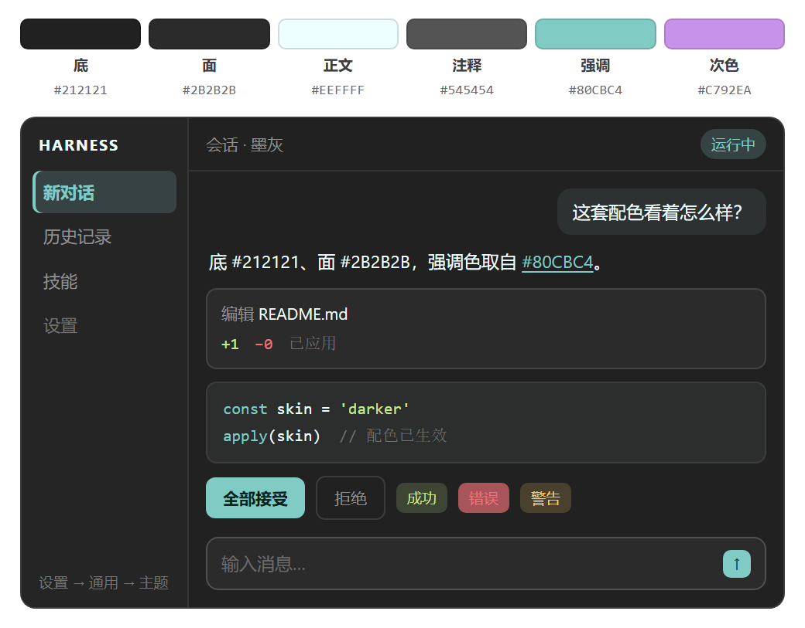
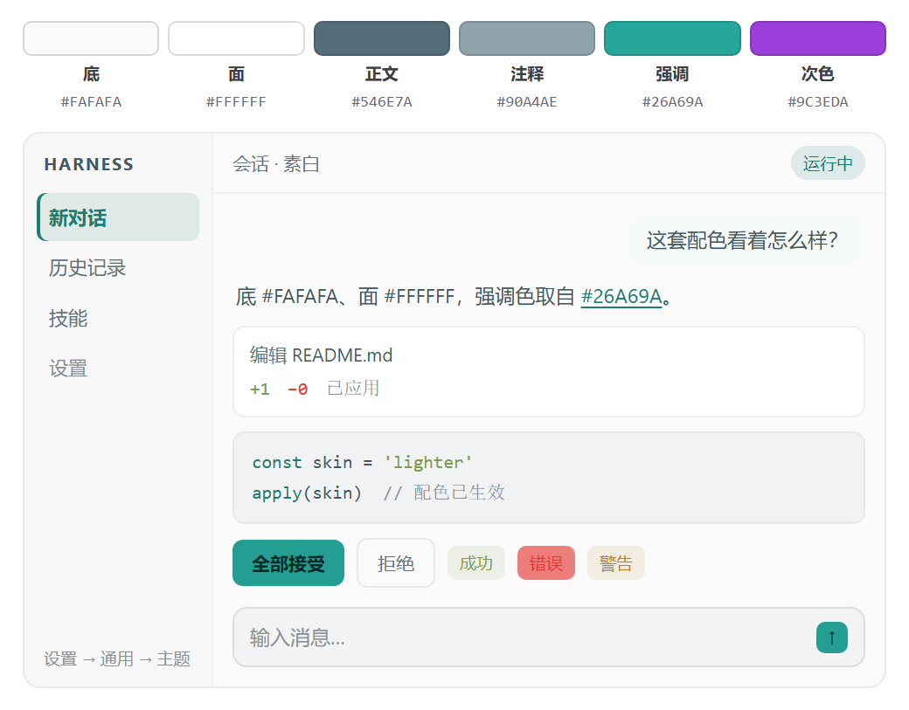
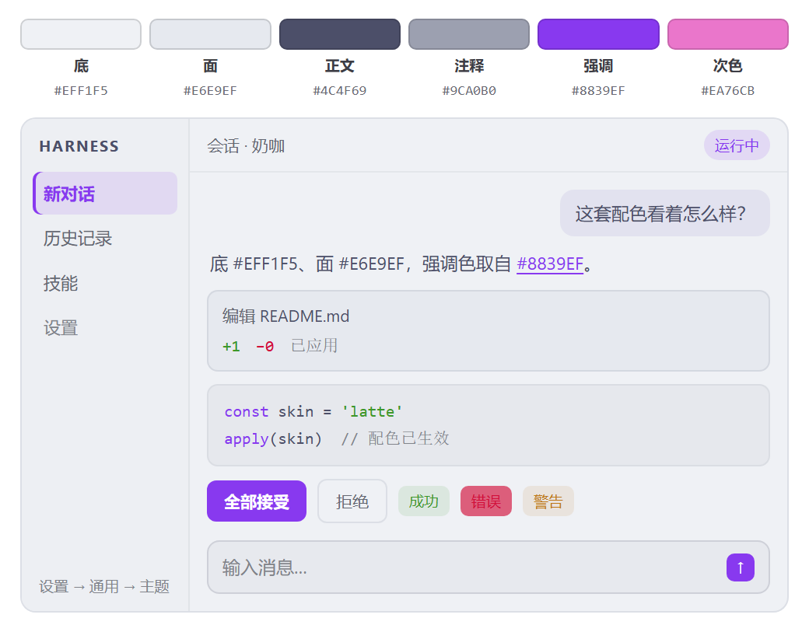
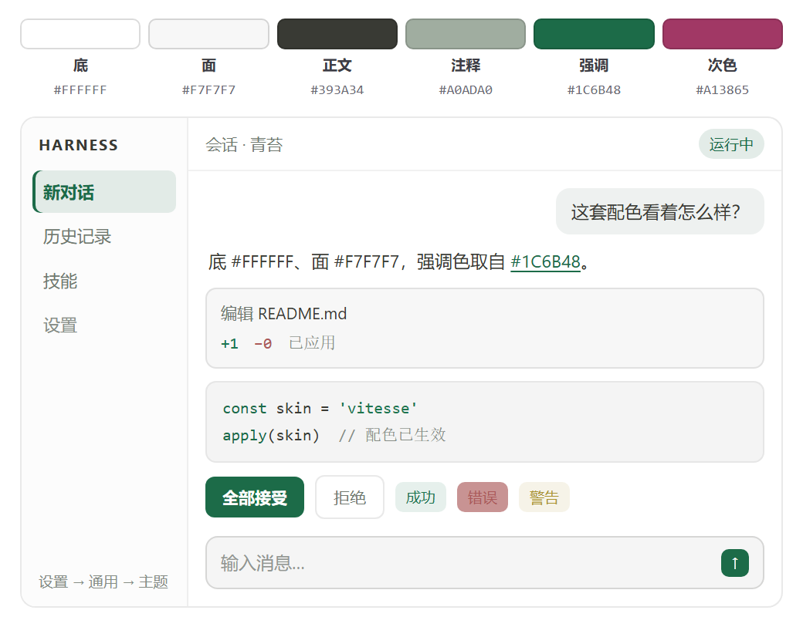
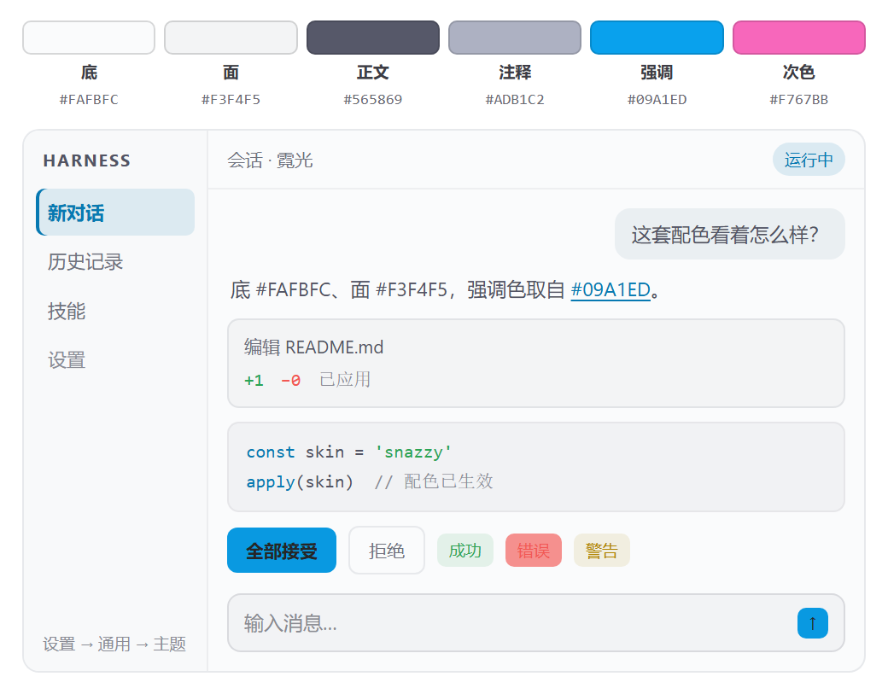
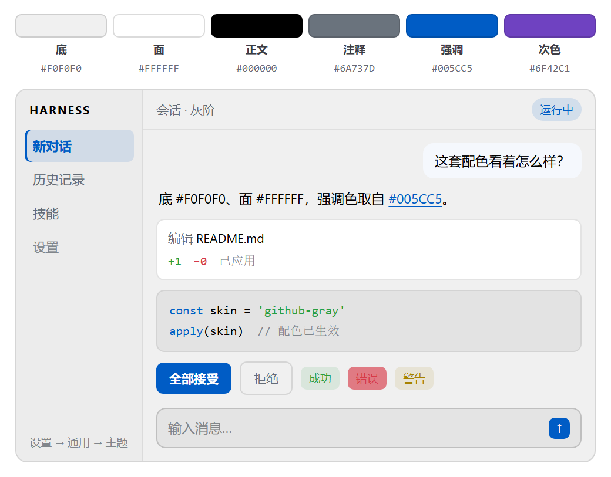

# dsh-theme-material

给 DeepSeek Harness 用的配色主题包：**八套主题，深浅都有，在设置里点一下就能换。**

## 安装

应用内打开「插件 → 添加插件」，填：

```
github:heinrich0505/dsh-theme-material
```

装好按提示刷新窗口。网页端 profile 也可以用命令行：

```sh
dsh plugin --profile web add github:heinrich0505/dsh-theme-material
```

## 换主题

**设置 → 通用 → 主题**，点一张色卡就换。



选深色主题（夜紫、幽蓝、墨灰）时，插件会把「外观」一起切到深色；选浅色主题（其余五套）会切回浅色。之后你手动改「外观」就按你的来，插件不会再抢。

选中的是哪套记在浏览器本地，同一台机器的不同浏览器可以各用一套。

## 八套主题

| 主题 | 底色 | 强调色 | 一句话 |
| --- | --- | --- | --- |
| **夜紫 Palenight** | `#292D3E` | `#80CBC4` | Material 最有名的一套，靛蓝灰底、青绿强调，侧栏和正文同色 |
| **幽蓝 Ocean** | `#0F111A` | `#80CBC4` | 压到近黑的深蓝，状态色是屏幕上唯一还亮着的东西 |
| **墨灰 Darker** | `#212121` | `#80CBC4` | 中性纯灰，不带色相，最不抢眼 |
| **素白 Lighter** | `#FAFAFA` | `#26A69A` | Material 唯一的浅色主题：冷白纸面、蓝灰字、青绿强调 |
| **奶咖 Latte** | `#EFF1F5` | `#8839EF` | Catppuccin 的浅色：灰紫底、紫强调，软而不刺眼 |
| **青苔 Vitesse** | `#FFFFFF` | `#1C6B48` | 近乎纯白的极简底加一抹墨绿，彩度全场最低 |
| **霓光 Snazzy** | `#FAFBFC` | `#09A1ED` | 冷白底配亮青强调，安静里带一点电 |
| **灰阶 GitHub Gray** | `#F0F0F0` | `#005CC5` | 整屏灰底配纯黑字的 GitHub 灰版 |

下面按上表顺序，每套一张实际效果图。图里上面的色块是这套主题的六个底色，下面是这套配色下的完整界面：侧栏、消息气泡、工具卡片、代码块、状态按钮、输入框。

### 夜紫 Palenight · 深色



### 幽蓝 Ocean · 深色



### 墨灰 Darker · 深色



### 素白 Lighter · 浅色



### 奶咖 Catppuccin Latte · 浅色



### 青苔 Vitesse · 浅色



### 霓光 Snazzy · 浅色



### 灰阶 GitHub Gray · 浅色



## 一个主题只定十个颜色

每套主题在 `src/skins.mjs` 里只写十个颜色：底色、卡片面、正文、注释、强调色、次强调，以及几个状态色的来源。其余的按钮、输入框、边框、代码块、提示条颜色，由 `src/derive.mjs` 按用途算出来。

算的时候会保证读得清：正文对比度不低于 7:1，次要文字不低于 4.5:1，按钮上的字也不低于 4.5:1。达不到就往黑或白两个方向调最近的。

想自己做一套，复制 `src/skins.mjs` 里任意一段改颜色，然后跑：

```sh
npm run verify
```

它会把每套主题的对比度打出来，哪一对不够清楚会直接标出来。

一套主题只写了它原生那一面的颜色，另一面自动补：深色主题的浅色版统一用 Material Lighter；浅色主题的深色版是中性夜色加这套主题自己的强调色。

## 许可

MIT